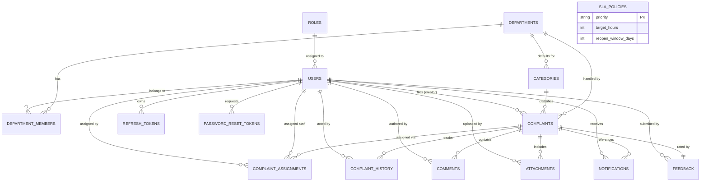
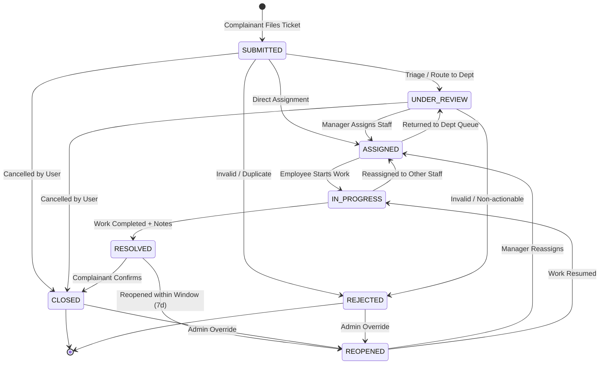

# ResolveIt — Online Complaint & Grievance Management System

> **Comprehensive Engineering Specification & DBMS-Oriented Project Report**  
> **Architecture:** Three-Tier Modular Monolith (`React 18 + Vite` | `Spring Boot 3.3.5 REST API` | `PostgreSQL 16+`)  
> **Security:** Spring Security 6, Stateless JWT Authentication, BCrypt, RBAC, Rate-Limiting  
> **Data Integrity:** Flyway Database Migrations, Optimistic Locking, Partial Unique Indexes, JSONB Audit Trail  

---

## Table of Contents

1. [Executive Summary & Problem Statement](#1-executive-summary--problem-statement)
2. [System Architecture & Technology Stack](#2-system-architecture--technology-stack)
3. [DBMS Engineering & Data Modeling (Detailed Report)](#3-dbms-engineering--data-modeling-detailed-report)
   - [3.1 Database Technology Selection & Rationale](#31-database-technology-selection--rationale)
   - [3.2 Conceptual Entity-Relationship (ER) Diagram](#32-conceptual-entity-relationship-er-diagram)
   - [3.3 Relational Schema Data Dictionary](#33-relational-schema-data-dictionary)
   - [3.4 Database Normalization Analysis (1NF to BCNF)](#34-database-normalization-analysis-1nf-to-bcnf)
   - [3.5 Relational Constraints & Business Rules](#35-relational-constraints--business-rules)
   - [3.6 Indexing Strategy & Query Optimization](#36-indexing-strategy--query-optimization)
   - [3.7 Transaction Management & Concurrency Control](#37-transaction-management--concurrency-control)
   - [3.8 Semi-Structured Data & Audit Logging (JSONB)](#38-semi-structured-data--audit-logging-jsonb)
   - [3.9 Database Migration Discipline (Flyway)](#39-database-migration-discipline-flyway)
4. [Business Logic & Workflow Engine](#4-business-logic--workflow-engine)
   - [4.1 Finite State Machine (FSM) Lifecycle](#41-finite-state-machine-fsm-lifecycle)
   - [4.2 SLA Calculation & Automated Escalation Engine](#42-sla-calculation--automated-escalation-engine)
   - [4.3 Role-Based Access Control (RBAC) Matrix](#43-role-based-access-control-rbac-matrix)
   - [4.4 Secure Evidence & File Handling Architecture](#44-secure-evidence--file-handling-architecture)
5. [RESTful API Specification](#5-restful-api-specification)
6. [Frontend User Experience & Architecture](#6-frontend-user-experience--architecture)
7. [Comprehensive Setup Guide for Any Device](#7-comprehensive-setup-guide-for-any-device)
   - [7.1 Prerequisites Checklist](#71-prerequisites-checklist)
   - [7.2 Option A: Zero-Config Docker Compose (Windows, macOS, Linux)](#72-option-a-zero-config-docker-compose-windows-macos-linux)
   - [7.3 Option B: Native Manual Setup (Step-by-Step)](#73-option-b-native-manual-setup-step-by-step)
   - [7.4 Option C: Local Network (LAN) Multi-Device Access](#74-option-c-local-network-lan-multi-device-access)
8. [Verification, Seeded Accounts & Testing](#8-verification-seeded-accounts--testing)
   - [8.1 Default Demo Credentials](#81-default-demo-credentials)
   - [8.2 Automated Backend & Frontend Tests](#82-automated-backend--frontend-tests)
   - [8.3 Live End-to-End Audit Suite](#83-live-end-to-end-audit-suite)
9. [Troubleshooting & FAQ](#9-troubleshooting--faq)

---

## 1. Executive Summary & Problem Statement

Organizations, educational institutions, and municipalities often struggle with fragmented, informal grievance channels (untracked emails, paper memos, and messaging apps). These ad-hoc methods suffer from:
- **Lack of Transparency:** Complainants cannot track ticket progress or deadlines.
- **Accountability Gaps:** Complaints get lost between departments with no clear individual owner.
- **SLA Breaches:** Critical issues (e.g., electrical safety or water supply failures) go unaddressed without automated alerts.
- **Inadequate Auditability:** Inability to reconstruct the chronological sequence of triage, inspection, reassignment, and resolution.

**ResolveIt** solves these problems by providing an enterprise-grade, transparent, auditable, and automated complaint resolution system. It implements single-active-owner staff assignments, rigorous state-machine transitions, SLA countdown tracking with background auto-escalation, public tracking without forced account creation, and fine-grained role-based visibility.

---

## 2. System Architecture & Technology Stack

The project follows a clean **Three-Tier Modular Monolith** architecture:

```
[ Browser / Mobile Client ] (React 18 + Vite SPA)
           │
           │  HTTP/REST + JWT (Port 5173 / Reverse Proxy)
           ▼
[ Application Tier ] (Spring Boot 3.3.5 on Port 8080)
   ├── Security & Filters (RateLimiter, JwtFilter, CORS)
   ├── REST Controllers (Auth, Complaints, Assignments, Reports, etc.)
   ├── Service Layer (TransitionPolicy, SlaService, FileStorage)
   └── Spring Data JPA / Hibernate ORM Layer
           │
           │  JDBC Connection Pool (HikariCP, Port 5432)
           ▼
[ Database Tier ] (PostgreSQL 16+)
   ├── Flyway Schema Migrations (V1 Schema, V2 Reference Data)
   ├── Relational Tables (15 Tables with Foreign Keys & Constraints)
   ├── Partial Unique Indexes & Composite Performance Indexes
   └── PostgreSQL Native Sequence (complaint_number_seq)
```

### Technology Breakdown

| Tier | Technology | Purpose |
| :--- | :--- | :--- |
| **Frontend** | React 18, Vite 5, Tailwind CSS 3 | Fast Single Page Application (SPA), accessible forms, real-time charts |
| **Routing & State** | React Router DOM 6, React Context API | Client-side role-guarded routes, persistent JWT session lifecycle |
| **HTTP & Networking** | Axios 1.7 with Custom Interceptors | Automatic JWT access token rotation, request queuing on refresh |
| **Visualizations** | Recharts 2.13, Lucide React Icons | Metric cards, monthly submission/resolution trends, department bars |
| **Backend Framework** | Java 17 LTS, Spring Boot 3.3.5 | Production-ready RESTful web services, dependency injection, schedulers |
| **Security & Auth** | Spring Security 6, JJWT 0.12.6, BCrypt | Stateless bearer token authentication, HMAC-SHA512 signing, IP rate limiting |
| **Persistence** | Spring Data JPA, Hibernate 6.5 | Object-Relational Mapping, Criteria API specifications, optimistic locking |
| **Database** | PostgreSQL 16+ (tested on 16, 17 & 18) | ACID transactions, partial unique indexes, JSONB columns, check constraints |
| **Schema Evolution** | Flyway Core & Flyway Database PostgreSQL | Version-controlled, reproducible SQL migration scripts |
| **Documentation** | SpringDoc OpenAPI 2.6 (Swagger UI) | Interactive API exploration and JSON schema specification |
| **Containerization** | Docker, Docker Compose, Nginx Alpine | Multi-stage production container builds and orchestrated local deployments |

---

## 3. DBMS Engineering & Data Modeling (Detailed Report)

### 3.1 Database Technology Selection & Rationale

PostgreSQL was selected over traditional MySQL or MongoDB based on foundational DBMS principles:

1. **Strict ACID Compliance & Transactional Reliability:** Complaint status changes, assignment handoffs, and audit logging must commit atomically. Partial updates (e.g., ticket resolved without an audit history record) corrupt the grievance record.
2. **Partial (Filtered) Unique Indexing:** The business rule *"A complaint may have many historical assignments, but exactly ONE active assignment at any given time"* cannot be cleanly represented by standard unique constraints. PostgreSQL supports filtered unique indexes (`WHERE active = TRUE`), guaranteeing single-assignee invariants at the engine level without application-level race conditions.
3. **Hybrid Relational + Semi-Structured Storage (`JSONB`):** Workflow events generate varying metadata (e.g., reassignment carries previous and new employee IDs; SLA escalation carries breach delta; priority adjustments carry old/new deadlines). Storing this in indexed `JSONB` avoids schema churn while maintaining query capability.
4. **Time-Zone Aware Temporal Integrity (`TIMESTAMPTZ`):** Global/distributed operation requires UTC storage of timestamps to calculate SLA deadlines accurately across time zones.
5. **Thread-Safe Atomic Sequences:** High concurrency requires lock-free tracking number generation (`nextval('complaint_number_seq')`), eliminating table lock contention during ticket creation.

---

### 3.2 Conceptual Entity-Relationship (ER) Diagram



---

### 3.3 Relational Schema Data Dictionary

The physical schema is established via Flyway migration [`V1__init_schema.sql`](file:///c:/Users/gargt/Downloads/Spring_Student_Management-main/Assignment/Project/backend/src/main/resources/db/migration/V1__init_schema.sql).

#### 1. Table: `roles`
Stores application authorization roles.
| Column | Type | Constraints | Description |
| :--- | :--- | :--- | :--- |
| `id` | `BIGINT` | `PK, GENERATED BY DEFAULT AS IDENTITY` | Role surrogate identifier |
| `name` | `VARCHAR(30)` | `NOT NULL, UNIQUE` | Role name (`ROLE_USER`, `ROLE_ADMIN`, etc.) |

#### 2. Table: `departments`
Represents operational units that handle grievances.
| Column | Type | Constraints | Description |
| :--- | :--- | :--- | :--- |
| `id` | `BIGINT` | `PK, GENERATED BY DEFAULT AS IDENTITY` | Department surrogate identifier |
| `name` | `VARCHAR(100)` | `NOT NULL, UNIQUE` | Department name |
| `description` | `TEXT` | `NULLABLE` | Functional scope of the department |
| `active` | `BOOLEAN` | `NOT NULL, DEFAULT TRUE` | Soft-deletion flag |
| `created_at` | `TIMESTAMPTZ` | `NOT NULL, DEFAULT NOW()` | Creation timestamp (UTC) |

#### 3. Table: `users`
User account credentials, authorization role, and security state.
| Column | Type | Constraints | Description |
| :--- | :--- | :--- | :--- |
| `id` | `BIGINT` | `PK, GENERATED BY DEFAULT AS IDENTITY` | User surrogate identifier |
| `name` | `VARCHAR(120)` | `NOT NULL` | Full personal name |
| `email` | `VARCHAR(255)` | `NOT NULL, UNIQUE` | Lowercase email address (login identifier) |
| `password_hash` | `VARCHAR(255)` | `NOT NULL` | BCrypt password hash (cost factor 10) |
| `role_id` | `BIGINT` | `NOT NULL, FK -> roles(id)` | User role reference |
| `active` | `BOOLEAN` | `NOT NULL, DEFAULT TRUE` | Account active status |
| `failed_login_attempts`| `INTEGER` | `NOT NULL, DEFAULT 0` | Counter for brute-force lockouts |
| `locked_until` | `TIMESTAMPTZ` | `NULLABLE` | Temporary lockout expiration time |
| `created_at` | `TIMESTAMPTZ` | `NOT NULL, DEFAULT NOW()` | Registration timestamp |
| `updated_at` | `TIMESTAMPTZ` | `NOT NULL, DEFAULT NOW()` | Last profile update timestamp |

#### 4. Table: `department_members`
Associative table linking users (employees and managers) to departments.
| Column | Type | Constraints | Description |
| :--- | :--- | :--- | :--- |
| `id` | `BIGINT` | `PK, GENERATED BY DEFAULT AS IDENTITY` | Membership surrogate identifier |
| `department_id` | `BIGINT` | `NOT NULL, FK -> departments(id)` | Department reference |
| `user_id` | `BIGINT` | `NOT NULL, FK -> users(id)` | User reference |
| `member_type` | `VARCHAR(20)` | `NOT NULL, CHECK (member_type IN ('MANAGER','EMPLOYEE'))` | Designation within department |
| `active` | `BOOLEAN` | `NOT NULL, DEFAULT TRUE` | Active assignment status |
| `joined_at` | `TIMESTAMPTZ` | `NOT NULL, DEFAULT NOW()` | Date assigned to department |
| *Composite* | `UNIQUE` | `(department_id, user_id)` | Prevents duplicate user enrollment |

#### 5. Table: `categories`
Complaint categories with default routing department.
| Column | Type | Constraints | Description |
| :--- | :--- | :--- | :--- |
| `id` | `BIGINT` | `PK, GENERATED BY DEFAULT AS IDENTITY` | Category surrogate identifier |
| `name` | `VARCHAR(100)` | `NOT NULL, UNIQUE` | Category title |
| `description` | `TEXT` | `NULLABLE` | Scope explanation |
| `default_department_id` | `BIGINT`| `NULLABLE, FK -> departments(id)` | Auto-routing department |
| `active` | `BOOLEAN` | `NOT NULL, DEFAULT TRUE` | Active toggle |

#### 6. Table: `sla_policies`
Service Level Agreement matrix defining resolution targets by priority.
| Column | Type | Constraints | Description |
| :--- | :--- | :--- | :--- |
| `id` | `BIGINT` | `PK, GENERATED BY DEFAULT AS IDENTITY` | Policy surrogate identifier |
| `priority` | `VARCHAR(20)` | `NOT NULL, UNIQUE, CHECK (priority IN ('LOW','MEDIUM','HIGH','CRITICAL'))` | Severity level |
| `target_hours` | `INTEGER` | `NOT NULL, CHECK (target_hours > 0)` | Maximum resolution window (hours) |
| `reopen_window_days`| `INTEGER` | `NOT NULL, DEFAULT 7, CHECK (reopen_window_days >= 0)` | Allowed period to reopen resolved ticket |
| `updated_at` | `TIMESTAMPTZ` | `NOT NULL, DEFAULT NOW()` | Policy revision timestamp |

#### 7. Table: `complaints`
The core transactional entity representing a filed grievance.
| Column | Type | Constraints | Description |
| :--- | :--- | :--- | :--- |
| `id` | `BIGINT` | `PK, GENERATED BY DEFAULT AS IDENTITY` | Primary key |
| `complaint_number` | `VARCHAR(30)` | `NOT NULL, UNIQUE` | Human-readable tracking number (e.g., `CMP-2026-000004`) |
| `title` | `VARCHAR(200)` | `NOT NULL` | Complaint summary headline |
| `description` | `TEXT` | `NOT NULL` | Detailed problem description |
| `priority` | `VARCHAR(20)` | `NOT NULL, DEFAULT 'MEDIUM', CHECK (priority IN (...))` | Ticket urgency |
| `status` | `VARCHAR(30)` | `NOT NULL, DEFAULT 'SUBMITTED', CHECK (status IN (...))` | Current state in FSM |
| `creator_id` | `BIGINT` | `NOT NULL, FK -> users(id)` | Complainant reference |
| `department_id` | `BIGINT` | `NULLABLE, FK -> departments(id)` | Assigned handling department |
| `category_id` | `BIGINT` | `NOT NULL, FK -> categories(id)` | Problem category |
| `location` | `VARCHAR(255)` | `NULLABLE` | Physical room/block/site |
| `due_at` | `TIMESTAMPTZ` | `NULLABLE` | SLA deadline timestamp |
| `resolved_at` | `TIMESTAMPTZ` | `NULLABLE` | Timestamp when marked RESOLVED |
| `closed_at` | `TIMESTAMPTZ` | `NULLABLE` | Timestamp when marked CLOSED |
| `is_escalated` | `BOOLEAN` | `NOT NULL, DEFAULT FALSE` | Flag indicating SLA deadline breach |
| `escalated_at` | `TIMESTAMPTZ` | `NULLABLE` | Timestamp when auto-escalated |
| `resolution_notes` | `TEXT` | `NULLABLE` | Summary provided by resolving technician |
| `version` | `BIGINT` | `NOT NULL, DEFAULT 0` | Optimistic locking control counter |
| `created_at` | `TIMESTAMPTZ` | `NOT NULL, DEFAULT NOW()` | Ticket creation timestamp |
| `updated_at` | `TIMESTAMPTZ` | `NOT NULL, DEFAULT NOW()` | Last update timestamp |

#### 8. Table: `complaint_assignments`
Maintains assignment history with single-active-assignee enforcement.
| Column | Type | Constraints | Description |
| :--- | :--- | :--- | :--- |
| `id` | `BIGINT` | `PK, GENERATED BY DEFAULT AS IDENTITY` | Assignment surrogate identifier |
| `complaint_id` | `BIGINT` | `NOT NULL, FK -> complaints(id)` | Associated complaint |
| `employee_id` | `BIGINT` | `NOT NULL, FK -> users(id)` | Assigned technician |
| `assigned_by` | `BIGINT` | `NOT NULL, FK -> users(id)` | Manager or admin who assigned |
| `assigned_at` | `TIMESTAMPTZ` | `NOT NULL, DEFAULT NOW()` | Assignment handoff timestamp |
| `unassigned_at` | `TIMESTAMPTZ` | `NULLABLE` | Timestamp when reassigned |
| `reason` | `TEXT` | `NULLABLE` | Assignment/reassignment justification |
| `active` | `BOOLEAN` | `NOT NULL, DEFAULT TRUE` | Active assignment status |

#### 9. Table: `complaint_history`
Append-only immutable audit trail capturing all lifecycle events.
| Column | Type | Constraints | Description |
| :--- | :--- | :--- | :--- |
| `id` | `BIGINT` | `PK, GENERATED BY DEFAULT AS IDENTITY` | Audit record identifier |
| `complaint_id` | `BIGINT` | `NOT NULL, FK -> complaints(id)` | Associated complaint |
| `actor_id` | `BIGINT` | `NULLABLE, FK -> users(id)` | User who executed the action |
| `event_type` | `VARCHAR(40)` | `NOT NULL` | Event tag (`CREATED`, `ASSIGNED`, `RESOLVED`, etc.) |
| `old_status` | `VARCHAR(30)` | `NULLABLE` | Status before transition |
| `new_status` | `VARCHAR(30)` | `NULLABLE` | Status after transition |
| `reason` | `TEXT` | `NULLABLE` | Reason notes supplied with transition |
| `metadata` | `JSONB` | `NULLABLE` | Structured event context payload |
| `created_at` | `TIMESTAMPTZ` | `NOT NULL, DEFAULT NOW()` | Event occurrence timestamp |

#### 10. Table: `comments`
Public dialogue and staff-only internal work logs.
| Column | Type | Constraints | Description |
| :--- | :--- | :--- | :--- |
| `id` | `BIGINT` | `PK, GENERATED BY DEFAULT AS IDENTITY` | Comment primary key |
| `complaint_id` | `BIGINT` | `NOT NULL, FK -> complaints(id)` | Associated complaint |
| `author_id` | `BIGINT` | `NOT NULL, FK -> users(id)` | Author user reference |
| `body` | `TEXT` | `NOT NULL` | Comment body text |
| `visibility` | `VARCHAR(15)` | `NOT NULL, DEFAULT 'PUBLIC', CHECK (visibility IN ('PUBLIC','INTERNAL'))` | Access level |
| `created_at` | `TIMESTAMPTZ` | `NOT NULL, DEFAULT NOW()` | Submission timestamp |
| `updated_at` | `TIMESTAMPTZ` | `NOT NULL, DEFAULT NOW()` | Modification timestamp |

#### 11. Table: `attachments`
Evidence files metadata (actual binaries stored securely on disk).
| Column | Type | Constraints | Description |
| :--- | :--- | :--- | :--- |
| `id` | `BIGINT` | `PK, GENERATED BY DEFAULT AS IDENTITY` | Attachment primary key |
| `complaint_id` | `BIGINT` | `NOT NULL, FK -> complaints(id)` | Associated complaint |
| `uploader_id` | `BIGINT` | `NOT NULL, FK -> users(id)` | User who uploaded |
| `original_filename`| `VARCHAR(255)`| `NOT NULL` | Cleaned original file name |
| `storage_key` | `VARCHAR(500)`| `NOT NULL, UNIQUE` | UUID-based relative disk storage key |
| `content_type` | `VARCHAR(120)`| `NOT NULL` | Verified MIME type |
| `size_bytes` | `BIGINT` | `NOT NULL, CHECK (size_bytes > 0)` | File payload size in bytes |
| `checksum` | `VARCHAR(128)`| `NULLABLE` | Hex SHA-256 integrity hash |
| `created_at` | `TIMESTAMPTZ` | `NOT NULL, DEFAULT NOW()` | Upload timestamp |

#### 12. Table: `feedback`
Post-resolution ratings and reviews.
| Column | Type | Constraints | Description |
| :--- | :--- | :--- | :--- |
| `id` | `BIGINT` | `PK, GENERATED BY DEFAULT AS IDENTITY` | Feedback primary key |
| `complaint_id` | `BIGINT` | `NOT NULL, UNIQUE, FK -> complaints(id)` | Strict 1:1 relationship with complaint |
| `user_id` | `BIGINT` | `NOT NULL, FK -> users(id)` | Complainant reference |
| `rating` | `SMALLINT` | `NOT NULL, CHECK (rating BETWEEN 1 AND 5)` | 1 to 5 star rating |
| `comment` | `TEXT` | `NULLABLE` | Complainant feedback review text |
| `created_at` | `TIMESTAMPTZ` | `NOT NULL, DEFAULT NOW()` | Submission timestamp |

#### 13. Table: `notifications`
In-app user notification alerts.
| Column | Type | Constraints | Description |
| :--- | :--- | :--- | :--- |
| `id` | `BIGINT` | `PK, GENERATED BY DEFAULT AS IDENTITY` | Notification primary key |
| `recipient_id` | `BIGINT` | `NOT NULL, FK -> users(id)` | Receiving user reference |
| `complaint_id` | `BIGINT` | `NULLABLE, FK -> complaints(id)` | Context complaint reference |
| `type` | `VARCHAR(50)` | `NOT NULL` | Notification classification tag |
| `message` | `TEXT` | `NOT NULL` | User alert message |
| `read_at` | `TIMESTAMPTZ` | `NULLABLE` | Read acknowledgement timestamp |
| `created_at` | `TIMESTAMPTZ` | `NOT NULL, DEFAULT NOW()` | Timestamp created |

#### 14. Tables: `refresh_tokens` & `password_reset_tokens`
Cryptographic authentication state management.
- `refresh_tokens`: `(id, user_id, token_hash [UNIQUE], expires_at, revoked_at, created_at)`
- `password_reset_tokens`: `(id, user_id, token_hash [UNIQUE], expires_at, used_at, created_at)`

---

### 3.4 Database Normalization Analysis (1NF to BCNF)

The schema was designed adhering to relational normalization principles up to **Boyce-Codd Normal Form (BCNF)**:

1. **First Normal Form (1NF):**
   - Every column contains atomic (indivisible) values. No comma-delimited strings for assignments, comments, or attachments.
   - Each table has an explicit surrogate Primary Key (`BIGINT GENERATED BY DEFAULT AS IDENTITY`).
   - Order of rows and columns has no semantic significance.
2. **Second Normal Form (2NF):**
   - Satisfies 1NF.
   - In all tables with composite unique keys (e.g., `department_members` on `(department_id, user_id)`), non-key attributes (`member_type`, `active`, `joined_at`) depend on the *entire* key, not a partial subset.
3. **Third Normal Form (3NF):**
   - Satisfies 2NF.
   - No transitive dependencies exist ($X \to Y$ and $Y \to Z$). For example, department names are not stored in the `complaints` or `users` table; instead, a foreign key `department_id` references `departments(id)`. Modifying a department name requires updating exactly one row.
4. **Boyce-Codd Normal Form (BCNF):**
   - For every functional dependency $X \to Y$, $X$ is a superkey. All candidates and determinants in `sla_policies`, `users`, `departments`, and `roles` are candidate keys.
5. **Pragmatic Controlled Denormalization:**
   - In `complaints`, `department_id` is maintained alongside `category_id` (even though `categories` has a `default_department_id`). This supports **re-routing**: a complaint may initially fall under "Network & Wi-Fi" but subsequently be reassigned to "Facilities & Maintenance" without altering category history.

---

### 3.5 Relational Constraints & Business Rules

#### Enforcing Single Active Assignment via Partial Unique Index
A critical business rule is: **A complaint can have multiple past assignments, but at most ONE active assignee at any time.**
A standard unique constraint on `(complaint_id, employee_id)` would prevent an employee from ever being reassigned to a ticket they previously handled. A standard unique constraint on `complaint_id` would prevent multiple assignments from ever being logged.

PostgreSQL's **Partial Unique Index** solves this cleanly:
```sql
CREATE UNIQUE INDEX uq_active_assignment_per_complaint
    ON complaint_assignments(complaint_id)
    WHERE active = TRUE;
```
If two managers simultaneously attempt to assign different technicians to the same ticket, the database engine guarantees that only one transaction succeeds; the second transaction fails immediately with a unique constraint violation, preventing race conditions.

#### Domain Check Constraints
Invalid domain values are rejected at the database level regardless of whether a query originates from the backend or direct DB administration:
```sql
CHECK (member_type IN ('MANAGER', 'EMPLOYEE'))
CHECK (priority IN ('LOW', 'MEDIUM', 'HIGH', 'CRITICAL'))
CHECK (status IN ('SUBMITTED', 'UNDER_REVIEW', 'ASSIGNED', 'IN_PROGRESS', 'RESOLVED', 'CLOSED', 'REJECTED', 'REOPENED'))
CHECK (visibility IN ('PUBLIC', 'INTERNAL'))
CHECK (rating BETWEEN 1 AND 5)
CHECK (target_hours > 0)
CHECK (size_bytes > 0)
```

---

### 3.6 Indexing Strategy & Query Optimization

Indexes were designed based on workload patterns (read-heavy dashboards and frequent SLA status checks):

```sql
-- Fast filter for user personal complaint listings (Dashboard & My Complaints)
CREATE INDEX idx_complaints_creator_status
    ON complaints(creator_id, status);

-- Fast filter for Department Manager queues
CREATE INDEX idx_complaints_department_status
    ON complaints(department_id, status);

-- Chronological ordering for lists and pagination
CREATE INDEX idx_complaints_created_at
    ON complaints(created_at DESC);

-- Partial index for high-frequency SLA daemon scanner:
-- Scans only ACTIVE tickets with an SLA deadline; ignores CLOSED and REJECTED rows.
CREATE INDEX idx_complaints_due_at
    ON complaints(due_at)
    WHERE status NOT IN ('CLOSED', 'REJECTED');

-- Lookups for Employee personal work queue
CREATE INDEX idx_assignment_employee
    ON complaint_assignments(employee_id);

-- Subquery joins and timeline lookups
CREATE INDEX idx_history_complaint_created
    ON complaint_history(complaint_id, created_at);
CREATE INDEX idx_comments_complaint_created
    ON comments(complaint_id, created_at);

-- In-app notification bell counter & unread listing
CREATE INDEX idx_notifications_recipient_read
    ON notifications(recipient_id, read_at, created_at DESC);
```

---

### 3.7 Transaction Management & Concurrency Control

#### Optimistic Locking
In high-volume environments, two operators might review the same ticket concurrently. The `complaints` table features a `@Version BIGINT version` column.
If Operator A changes status from `ASSIGNED` to `IN_PROGRESS` while Operator B attempts to reject the ticket, Hibernate detects that `version` has advanced and throws an `OptimisticLockException`. This prevents silent data overwrites ("lost updates").

#### Spring Declarative Transactions
Database interactions in services are annotated with `@Transactional(readOnly = true)` for query optimization or `@Transactional` for writes. Multi-step operations (e.g., filing a complaint: insert complaint $\to$ record history event $\to$ create notification) execute within a single atomic database transaction. If notification generation fails, the entire transaction rolls back.

---

### 3.8 Semi-Structured Data & Audit Logging (JSONB)

The `complaint_history.metadata` column utilizes PostgreSQL's native binary JSON format (`JSONB`). This allows storing structured diagnostic data for each lifecycle event:

```json
{
  "category": "Water & Plumbing",
  "priority": "HIGH",
  "assignedEmployeeId": 6,
  "assignedEmployeeName": "Vikram Singh",
  "previousStatus": "UNDER_REVIEW",
  "targetStatus": "ASSIGNED"
}
```

Benefits:
- Eliminates the need for sparse or generic columns (`param1`, `param2`, `param3`).
- Can be indexed using GIN (`CREATE INDEX ... USING GIN(metadata)`) if querying nested JSON fields is required in the future.

---

### 3.9 Database Migration Discipline (Flyway)

Database migrations are strictly version-controlled via **Flyway**:
- [`V1__init_schema.sql`](file:///c:/Users/gargt/Downloads/Spring_Student_Management-main/Assignment/Project/backend/src/main/resources/db/migration/V1__init_schema.sql): DDL creating all sequences, tables, check constraints, partial indexes, and performance indexes.
- [`V2__seed_data.sql`](file:///c:/Users/gargt/Downloads/Spring_Student_Management-main/Assignment/Project/backend/src/main/resources/db/migration/V2__seed_data.sql): DML seeding standard system roles, SLA policies, reference departments, and categories.

On application startup, Flyway checks the `flyway_schema_history` table and applies pending migrations sequentially.

---

## 4. Business Logic & Workflow Engine

### 4.1 Finite State Machine (FSM) Lifecycle

The grievance lifecycle is managed by [TransitionPolicy.java](file:///c:/Users/gargt/Downloads/Spring_Student_Management-main/Assignment/Project/backend/src/main/java/com/resolveit/workflow/TransitionPolicy.java):



---

### 4.2 SLA Calculation & Automated Escalation Engine

1. **Target Calculation:** When a complaint is filed, `SlaService` calculates `due_at = created_at + target_hours`:
   - `CRITICAL`: 4 Hours
   - `HIGH`: 24 Hours
   - `MEDIUM`: 72 Hours
   - `LOW`: 120 Hours
2. **Scheduled Scanner:** A background daemon runs periodically (`APP_SLA_SCAN_DELAY_MS` default `60,000ms`), invoking:
   ```sql
   SELECT c FROM Complaint c
   WHERE c.dueAt IS NOT NULL AND c.dueAt < :now
     AND c.escalated = false
     AND c.status NOT IN ('RESOLVED', 'CLOSED', 'REJECTED')
   ```
3. **Escalation Action:** Flags `is_escalated = TRUE`, logs `escalated_at = NOW()`, records an audit event in `complaint_history`, and dispatches high-priority in-app alerts to Department Managers and Administrators.

---

### 4.3 Role-Based Access Control (RBAC) Matrix

| Capability | Complainant (`USER`) | Staff (`EMPLOYEE`) | Manager (`MANAGER`) | Administrator (`ADMIN`) |
| :--- | :---: | :---: | :---: | :---: |
| File Complaint | Yes | Yes (as citizen) | Yes (as citizen) | Yes (as citizen) |
| Public Track Ticket | Yes | Yes | Yes | Yes |
| View Own Complaints | Yes | Yes | Yes | Yes |
| View Department Queue | No | No | Yes (own dept) | Yes (all depts) |
| Assign / Reassign Staff | No | No | Yes (own dept) | Yes (all depts) |
| Start Work (`IN_PROGRESS`) | No | Yes (if assigned) | No | Yes |
| Resolve Ticket | No | Yes (if assigned) | Yes (own dept) | Yes |
| Reopen Ticket | Yes (within 7d) | No | No | Yes (unlimited) |
| Reject Ticket | No | No | Yes (own dept) | Yes |
| Post Public Comment | Yes (own ticket) | Yes (assigned) | Yes (own dept) | Yes |
| Post Internal Note | No (HTTP 403) | Yes (assigned) | Yes (own dept) | Yes |
| Submit 1-5 Star Feedback | Yes (own ticket) | No | No | No |
| Access Reports & CSV Export| No | No | Yes (own dept) | Yes (all depts) |
| Manage Users & Roles | No | No | No | Yes |
| Modify SLA Policies | No | No | No | Yes |

---

### 4.4 Secure Evidence & File Handling Architecture

1. **MIME & Extension Whitelisting:** Supports `pdf, png, jpg, jpeg, webp, txt, csv, doc, docx`.
2. **Magic-Byte Signature Inspection:** To prevent extension spoofing (e.g., renaming `malware.exe` to `proof.png`), the backend inspects leading file bytes:
   - PDF: `%PDF` (`0x25 0x50 0x44 0x46`)
   - PNG: `\x89PNG` (`0x89 0x50 0x4E 0x47`)
   - JPEG: `\xFF\xD8\xFF`
3. **Storage Security:** Files are stored outside the web root (`APP_FILE_STORAGE_PATH=./uploads`) using UUID filenames. Direct HTTP access is blocked; downloads are served exclusively through `GET /api/attachments/{id}/download` with authentication and access verification.
4. **Integrity:** Every stored file computes a hex-encoded SHA-256 checksum stored in the database.

---

## 5. RESTful API Specification

### 1. Authentication & Account (`/api/auth`)
- `POST /api/auth/register` — Create citizen account
- `POST /api/auth/login` — Authenticate and receive Access & Refresh JWTs
- `POST /api/auth/refresh` — Rotate access token using valid refresh token
- `POST /api/auth/logout` — Revoke active refresh token
- `POST /api/auth/forgot-password` & `reset-password` — Password recovery flow
- `GET /api/auth/me` & `PUT /api/auth/me` — Inspect and update profile

### 2. Complaints Management (`/api/complaints`)
- `POST /api/complaints` — Submit a complaint (with category, priority, location)
- `GET /api/complaints` — Paginated filtered complaint search
- `GET /api/complaints/{id}` — Full complaint details (guarded by access rights)
- `GET /api/complaints/track/{number}` — Unauthenticated public tracking
- `GET /api/complaints/potential-duplicates?categoryId=X` — Near-duplicate detection
- `PATCH /api/complaints/{id}` — Edit details prior to assignment
- `POST /api/complaints/{id}/cancel` — Complainant cancels ticket
- `POST /api/complaints/{id}/start` — Assigned employee marks in-progress
- `POST /api/complaints/{id}/resolve` — Mark resolved with resolution notes
- `POST /api/complaints/{id}/close` — Confirm ticket closure
- `POST /api/complaints/{id}/reopen` — Reopen ticket (with reason)
- `POST /api/complaints/{id}/reject` — Reject ticket (with reason)
- `GET /api/complaints/{id}/history` — Chronological audit timeline

### 3. Assignments & Staff Queues (`/api`)
- `POST /api/complaints/{id}/assignments` — Assign employee to complaint
- `POST /api/complaints/{id}/assignments/{assignmentId}/reassign` — Reassign employee
- `GET /api/complaints/{id}/assignments` — View assignment history
- `GET /api/employee/complaints` — Personal queue for logged-in technician
- `GET /api/manager/department-queue` — Manager's triage and workload queue
- `GET /api/manager/overdue` — Overdue tickets requiring intervention

### 4. Collaboration, Evidence & Feedback (`/api`)
- `POST /api/complaints/{id}/comments` — Add comment (`PUBLIC` or `INTERNAL`)
- `GET /api/complaints/{id}/comments` — List comments (internal notes filtered for citizens)
- `POST /api/complaints/{id}/attachments` — Upload multipart file
- `GET /api/complaints/{id}/attachments` — List file metadata
- `GET /api/attachments/{id}/download` — Stream attachment binary
- `POST /api/complaints/{id}/feedback` — Submit 1-5 star rating and review
- `GET /api/complaints/{id}/feedback` — Retrieve complaint feedback

### 5. Administration, Catalogs & Reports (`/api`)
- `GET /api/departments` *(Public)*, `POST /api/departments`, `PUT /api/departments/{id}`
- `GET /api/departments/{id}/members`, `POST/DELETE /api/departments/{id}/members`
- `GET /api/categories` *(Public)*, `POST /api/categories`, `PUT /api/categories/{id}`
- `GET /api/users`, `PUT /api/users/{id}/role`, `PATCH /api/users/{id}/status`
- `GET /api/admin/dashboard` — High-level operational KPIs
- `GET /api/admin/sla-policies`, `PUT /api/admin/sla-policies/{priority}` — Update SLA hours
- `GET /api/reports/summary`, `by-department`, `trends`, `resolution-time`
- `GET /api/reports/export` — Stream full CSV data export

---

## 6. Frontend User Experience & Architecture

The frontend is structured into isolated, role-specific views in `frontend/src/`:

```text
frontend/src/
|-- app/
|   |-- App.jsx               # Root provider wrapper
|   |-- router.jsx            # Role-guarded route definitions (<ProtectedRoute>)
|   `-- providers.jsx         # Context & theme composition
|-- context/
|   `-- AuthContext.jsx       # Global JWT state, login, logout, user profile
|-- services/
|   |-- apiClient.js          # Axios instance + auto-refresh promise queue
|   |-- authService.js        # Auth REST endpoints
|   |-- complaintService.js   # Complaint, assignment, comment, attachment endpoints
|   |-- departmentService.js  # Department and category administration
|   |-- notificationService.js# In-app alerts
|   |-- reportService.js      # Analytics and CSV export
|   `-- userService.js        # User management
|-- components/               # Navbar, Sidebar, Badge, Modal, KPI cards
`-- pages/
    |-- public/               # Landing, Login, Register, Track, ForgotPassword
    |-- user/                 # Dashboard, SubmitComplaint, MyComplaints
    |-- staff/                # EmployeeDashboard, ManagerDashboard
    |-- admin/                # AdminDashboard, Departments, Categories, Users, Reports
    `-- shared/               # ComplaintDetails, Notifications, Profile
```

### Automatic Token Refresh Interceptor (`apiClient.js`)
When an access token expires (HTTP 401), the custom Axios response interceptor pauses outgoing calls, queues subsequent requests in a `pendingQueue`, dispatches a single refresh call to `/api/auth/refresh`, updates `localStorage`, and replays all queued calls with the new token.

---

## 7. Comprehensive Setup Guide for Any Device

Follow these instructions to run ResolveIt on **Windows, macOS, or Linux**.

---

### 7.1 Prerequisites Checklist

| Component | Minimum Requirement | Check Command |
| :--- | :--- | :--- |
| **Java JDK** | 17 LTS or newer | `java -version` |
| **Node.js** | 18 LTS or newer | `node -v` |
| **npm** | 9+ | `npm -v` |
| **PostgreSQL** | 15, 16, 17, or 18 | `psql --version` |
| **Maven** | *Optional* (Maven Wrapper included) | `.\mvnw.cmd` / `./mvnw` |
| **Docker** | *Optional* (for container setup) | `docker --version` |

---

### 7.2 Option A: Zero-Config Docker Compose (Windows, macOS, Linux)

If you have Docker Desktop (Windows/macOS) or Docker Engine (Linux) installed, this is the fastest setup:

1. Open your terminal in the `Project` folder:
   ```bash
   cd path/to/Project
   ```
2. *(Optional)* Copy `.env.example` to `.env`:
   - **Windows PowerShell:** `Copy-Item .env.example .env`
   - **macOS / Linux:** `cp .env.example .env`
3. Launch the complete containerized stack:
   ```bash
   docker compose up --build
   ```
4. Access the applications:
   - **Web Application:** `http://localhost:5173`
   - **Backend API:** `http://localhost:8080/api`
   - **Swagger UI:** `http://localhost:8080/swagger-ui.html`
   - **Health Endpoint:** `http://localhost:8080/actuator/health`

To stop: `docker compose down` (use `docker compose down -v` to reset data volumes).

---

### 7.3 Option B: Native Manual Setup (Step-by-Step)

#### Step 1: Open Terminal & Configure `.env`
In the `Project/` root folder, create `.env`:
- **Windows PowerShell:**
  ```powershell
  Copy-Item .env.example .env
  ```
- **macOS / Linux:**
  ```bash
  cp .env.example .env
  ```

Ensure `.env` contains your PostgreSQL credentials (default `postgres` / your password):
```env
SPRING_DATASOURCE_URL=jdbc:postgresql://localhost:5432/resolveit
SPRING_DATASOURCE_USERNAME=postgres
SPRING_DATASOURCE_PASSWORD=YourLocalPostgresPassword
JWT_SECRET=ResolveItSuperSecretKeyForJwtSigningMustBeAtLeast256BitsLong2026!
APP_FRONTEND_ORIGIN=http://localhost:5173
APP_FILE_STORAGE_PATH=./uploads
APP_MAX_FILE_SIZE=10MB
APP_MAX_FILE_SIZE_BYTES=10485760
APP_MAIL_ENABLED=false
```

#### Step 2: Create PostgreSQL Database
Ensure your PostgreSQL server is running on port `5432`, then create the `resolveit` database:

- **Windows (PowerShell with PostgreSQL installed):**
  ```powershell
  & "C:\Program Files\PostgreSQL\18\bin\psql.exe" -U postgres -c "CREATE DATABASE resolveit;"
  ```
- **macOS (Homebrew):**
  ```bash
  brew services start postgresql@16
  psql postgres -c "CREATE DATABASE resolveit;"
  ```
- **Linux (Ubuntu / Debian):**
  ```bash
  sudo systemctl start postgresql
  sudo -u postgres psql -c "CREATE DATABASE resolveit;"
  ```

*(Flyway automatically creates all 15 tables and seeds default data on first backend boot!)*

#### Step 3: Run the Spring Boot Backend

- **Windows:**
  ```powershell
  cd backend
  .\mvnw.cmd spring-boot:run
  ```
- **macOS / Linux:**
  ```bash
  cd backend
  chmod +x mvnw
  ./mvnw spring-boot:run
  ```

Wait for the log message:
```text
Tomcat started on port 8080 (http) with context path '/'
Started ResolveItApplication in ... seconds
```

#### Step 4: Run the React Frontend
Open a **new terminal** window:
```bash
cd frontend
npm install
npm run dev
```

The frontend launches on **`http://localhost:5173`** and proxies API traffic to `localhost:8080`.

---

### 7.4 Option C: Local Network (LAN) Multi-Device Access

To access the platform from a smartphone or other devices on your local Wi-Fi:

1. Identify your computer's local IP address (e.g., `192.168.1.100` via `ipconfig` on Windows or `ifconfig`/`ip a` on macOS/Linux).
2. In `Project/.env`, update the frontend origin:
   ```env
   APP_FRONTEND_ORIGIN=http://localhost:5173,http://192.168.1.100:5173
   ```
3. Restart the backend to load the updated `.env`.
4. Run the frontend bound to all network interfaces:
   ```bash
   cd frontend
   npm run dev -- --host
   ```
5. Open `http://192.168.1.100:5173` on any mobile device or laptop connected to the same Wi-Fi.

---

## 8. Verification, Seeded Accounts & Testing

### 8.1 Default Demo Credentials

Pre-seeded by [DemoDataSeeder.java](file:///c:/Users/gargt/Downloads/Spring_Student_Management-main/Assignment/Project/backend/src/main/java/com/resolveit/config/DemoDataSeeder.java):

| Role | Name | Email | Password | Assigned Department |
| :--- | :--- | :--- | :--- | :--- |
| **Administrator** | System Admin | `admin@resolveit.local` | `Admin@1234` | Global System Access |
| **Department Manager**| Rohan Mehta | `manager@resolveit.local` | `Manager@1234` | Facilities & Maintenance |
| **Department Manager**| Neha Kapoor | `it.manager@resolveit.local` | `Manager@1234` | IT & Network Services |
| **Support Staff** | Vikram Singh | `employee@resolveit.local` | `Employee@1234` | Facilities & Maintenance |
| **Support Staff** | Sneha Nair | `sneha.staff@resolveit.local` | `Employee@1234` | Facilities & Maintenance |
| **Support Staff** | Karan Patel | `it.staff@resolveit.local` | `Employee@1234` | IT & Network Services |
| **Complainant (User)**| Aarav Sharma | `user@resolveit.local` | `User@1234` | Citizen / Complainant |
| **Complainant (User)**| Priya Verma | `priya@resolveit.local` | `User@1234` | Citizen / Complainant |

---

### 8.2 Automated Backend & Frontend Tests

#### Backend Test Suite (JUnit 5 + MockMvc + Mockito)
Verifies FSM state transitions, SLA calculations, role authorization, and IDOR isolation:
```bash
cd backend
./mvnw -B test          # Windows: .\mvnw.cmd -B test
```
*Result: `Tests run: 7, Failures: 0, Errors: 0, Skipped: 0` (`BUILD SUCCESS`).*

#### Frontend Test Suite & Production Build (Vitest + Vite)
```bash
cd frontend
npm test                # Vitest component & router unit tests
npm run build           # Validates TypeScript/JSX compilation into /dist
```
*Result: `3 passed (3)`, build generated in `dist/`.*

---

### 8.3 Live End-to-End Audit Suite

An automated end-to-end integration test is included in the project:
```bash
python audit_suite.py   # Windows / macOS / Linux
```
*Result:* **`46 PASSED, 0 FAILED`** across all authentication, ticket filing, duplicate detection, attachment upload/download, staff triage, in-progress handling, resolution notes, 5-star feedback, closure, and admin reports.

---

## 9. Troubleshooting & FAQ

#### 1. "Port 8080 was already in use"
An orphaned background Java process is holding port 8080.
- **Windows PowerShell:**
  ```powershell
  Get-NetTCPConnection -LocalPort 8080 -ErrorAction SilentlyContinue | ForEach-Object { Stop-Process -Id $_.OwningProcess -Force }
  ```
- **macOS / Linux:**
  ```bash
  lsof -ti:8080 | xargs kill -9
  ```

#### 2. "Database 'resolveit' does not exist"
PostgreSQL requires manual creation of the target database before Spring Boot boots.
Run: `CREATE DATABASE resolveit;` in your PostgreSQL client (see [Step 2](#step-2-create-postgresql-database)).

#### 3. "Permission denied: ./mvnw" (macOS / Linux)
The execution permission bit on the Maven Wrapper script needs to be set:
```bash
chmod +x backend/mvnw
```

#### 4. "ERROR: function lower(bytea) does not exist"
This occurs in Hibernate 6 if a query parameter inside `LOWER()` is untyped and null. All search queries in `UserRepository.java` have been safeguarded with `CAST(:search AS string)`. Ensure you are running the latest repository commit.

#### 5. "CORS error when accessing via LAN IP"
Ensure the exact URL (including port `5173`) of the visiting device is included in `APP_FRONTEND_ORIGIN` inside `Project/.env`.
